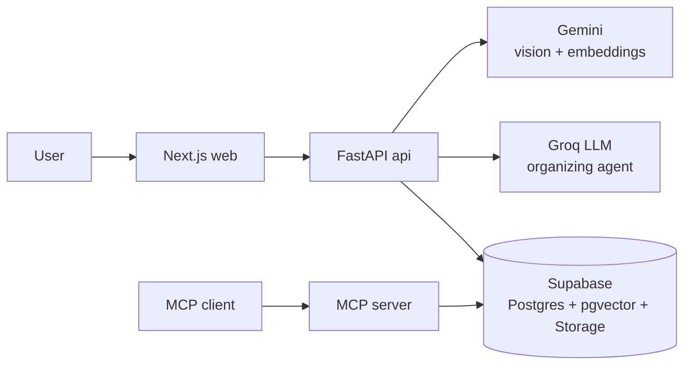

# Architecture

AI Asset Organizer turns a pile of uploaded files into an organized, searchable, shareable library.
This document explains how it works and the reasoning behind the design.

## Overview

The frontend is a Next.js app; all intelligence lives behind a FastAPI backend that talks to two
model providers and Supabase. A separate MCP server exposes the same capabilities as tools.

## The upload pipeline

Every file follows one path on upload:

1. **Store** — the raw file goes to a private Supabase Storage bucket.
2. **Extract** — content becomes text: Gemini vision describes images, `pypdf` reads PDFs, text
   files are read directly. This `content_text` is what everything downstream reasons over.
3. **Embed** — `content_text` is embedded (Gemini embeddings, 768-dim) into a pgvector column.

Extraction and embedding are best-effort: if either fails the upload still succeeds, the asset is
just not yet searchable.

## Model routing

Two models, each doing what it is best at:

- **Gemini** — multimodal, so it "sees" images and produces embeddings.
- **Groq** — a very fast hosted LLM, used for the organizing agent (the exact model is configurable via `GROQ_MODEL`).

A text-only model can't read an image, and one model for both jobs would compromise somewhere.
Routing keeps each step both capable and fast.

## Organizing — suggest and confirm

- `POST /organize/suggest` sends the unorganized assets' descriptions to the Groq agent, which
  returns a folder structure as JSON (JSON mode + low temperature for consistent grouping).
  **Nothing is changed** at this step.
- `POST /organize/apply` takes the plan the user has reviewed and edited, then creates the folders
  and assigns each asset.

The AI proposes; the human decides. That separation is deliberate — blind auto-organizing is easy
to get wrong and hard to trust.

## Semantic search (RAG)

This is the retrieval half of RAG. The query is embedded with the same model, and a Postgres
function (`match_assets`) ranks assets by cosine distance using an HNSW index. Search runs inside
the database, not the app, so it stays fast as the library grows.

## Sharing

A share is a token row pointing at a folder or an asset. Because the bucket is private, files are
served through short-lived signed URLs — access is controlled and links expire.

## MCP server

`list_assets`, `search_assets` and `suggest_folders` are also exposed over the Model Context
Protocol, so an MCP client (e.g. Claude Desktop) can drive the organizer directly. The REST API and
the MCP server share the same service layer — one implementation, two interfaces.

## Data model

| Table | Holds |
|-------|-------|
| `assets` | file metadata, `content_text`, `embedding vector(768)`, `folder_id`, `status` |
| `folders` | organized groups |
| `shares` | share tokens pointing at a folder or asset |

## Trade-offs & what's next

- Query and document embeddings use the default task type; `RETRIEVAL_QUERY` / `RETRIEVAL_DOCUMENT`
  task types would improve recall.
- Processing is synchronous on upload; a background queue (e.g. Celery) would scale better for large
  batches.
- No auth yet — this is a single-workspace demo. Per-user data with row-level security is the next step.
