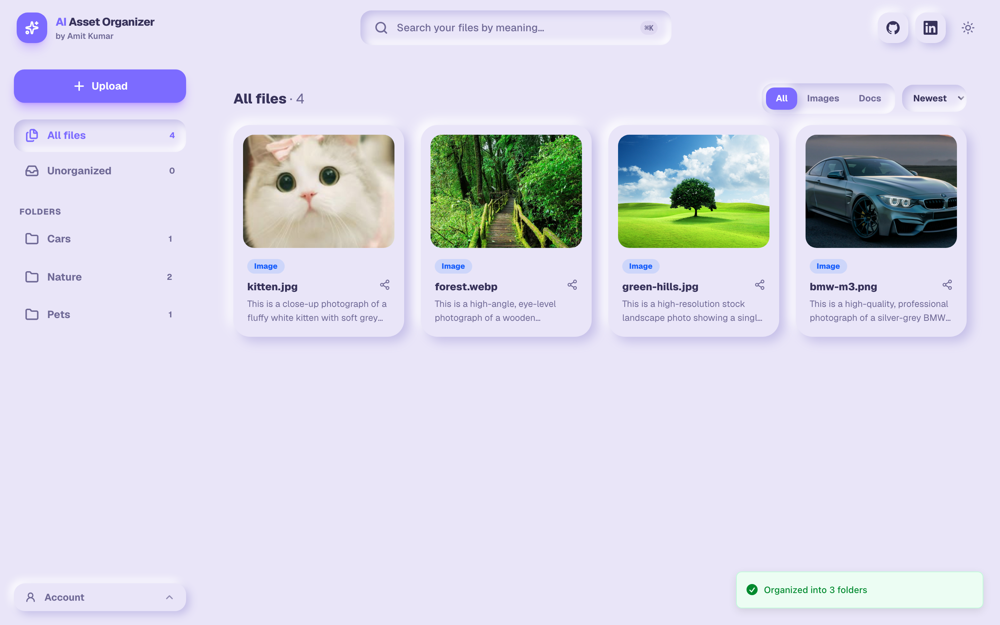
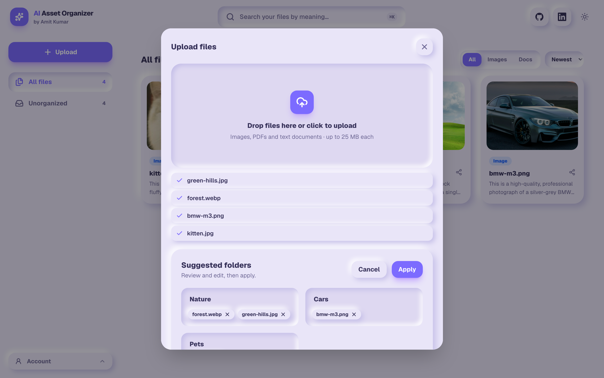
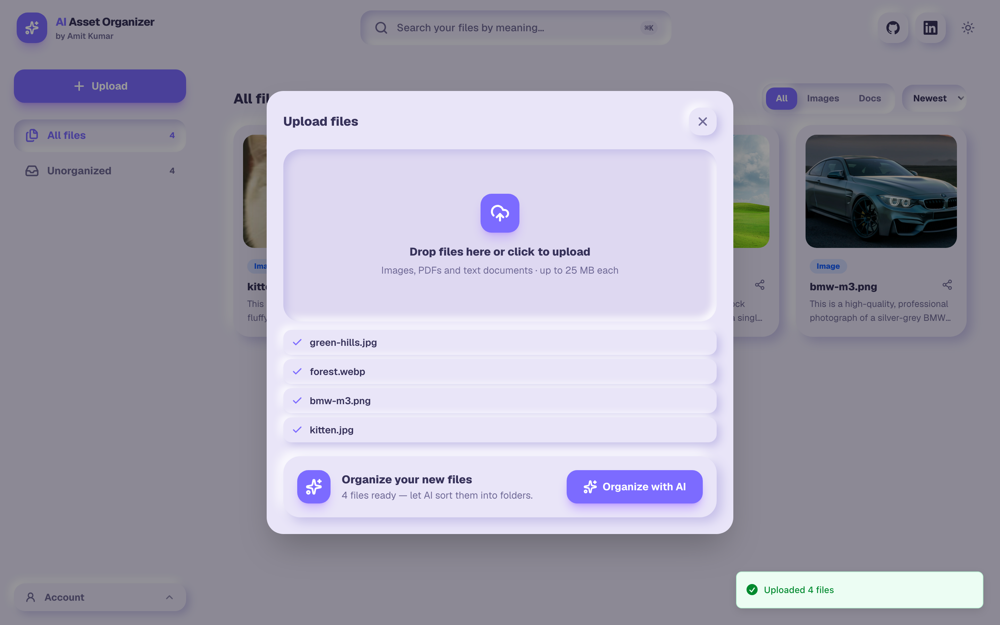
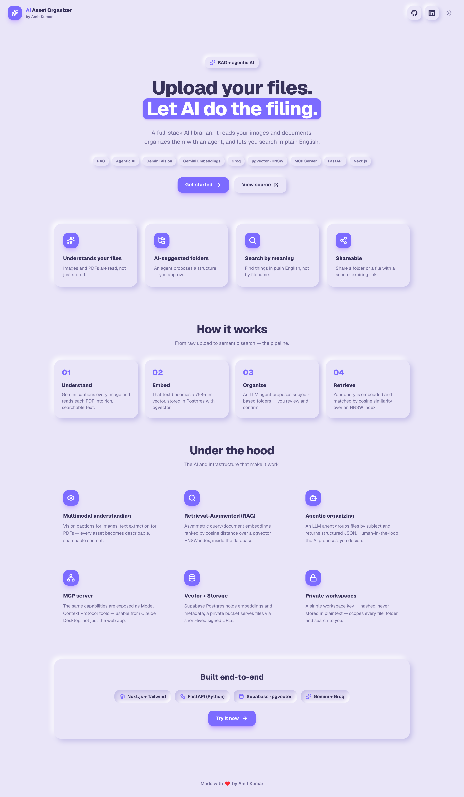
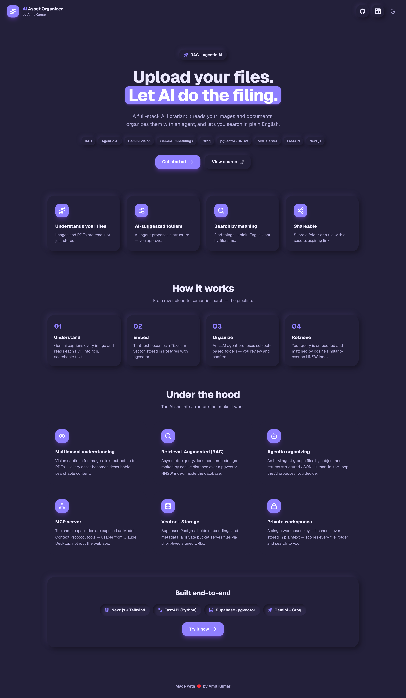

# AI Asset Organizer

Upload your files and let AI do the filing. Assets are understood, grouped into a suggested folder
structure you approve, and made searchable in plain English — "show me the invoices from March".

**Live demo → [ai-asset-organizer.vercel.app](https://ai-asset-organizer.vercel.app)**



## Highlights

- **Private workspaces** — a single sign-in key per workspace; you only ever see your own files.
- **Understands your assets** — images (vision) and PDFs (text) are read, not just stored.
- **Suggest-and-confirm organizing** — an AI agent proposes folders; you stay in control.
- **Semantic search (RAG)** — find things by meaning, not filename.
- **Shareable** — share a folder or a single asset with a link.
- **MCP server** — the organizer's capabilities are exposed as tools over the Model Context Protocol.

## Tech

| | |
|---|---|
| Frontend | Next.js, Tailwind, shadcn/ui, next-themes (dark/light) |
| Backend | FastAPI (Python) |
| Data | Supabase — Postgres + pgvector + Storage |
| AI | Groq (agent/chat) · Gemini (vision + embeddings) |

Two models by design: Gemini reads images/PDFs, Groq handles fast reasoning and chat — the right
model for each job.

## Structure

```
.
├── web/    # Next.js frontend
└── api/    # FastAPI backend
```

## Screenshots

AI suggests subject folders — you review and apply:



Uploading, with live per-file progress:



The landing page, light and dark:




## Getting started

- **Local dev:** run the backend (see [`api/README.md`](./api/README.md)) and the frontend
  (`cd web && npm install && npm run dev`).
- **Architecture:** see [ARCHITECTURE.md](./ARCHITECTURE.md).
- **Deployment:** see [DEPLOY.md](./DEPLOY.md).
